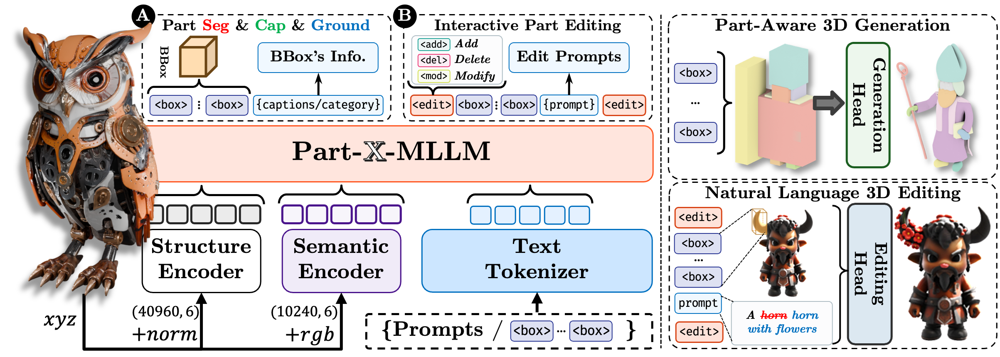

<p align="center">
  <h3 align="center"><strong>Part-X-MLLM: Part-aware 3D Multimodal Large Language Model</strong></h3>
    
<p align="center">
    <a href="https://chunshi.wang/">Chunshi Wang</a><sup>1,2†</sup>,
    <a href="https://jamesyjl.github.io/">Junliang Ye</a><sup>2,3†‡</sup>,
    <a href="https://yhyang-myron.github.io/">Yunhan Yang</a><sup>2,4†</sup>,
    <a href="https://yang-l1.github.io/">Yang Li</a><sup>2</sup>,<br>
    Zizhuo Lin<sup>1</sup>,
    <a href="https://ml.cs.tsinghua.edu.cn/~jun/">Jun Zhu</a><sup>3</sup>,
    Zhuo Chen<sup>2</sup>,
    <a href="https://scholar.google.com/citations?user=pnVwaGsAAAAJ">Yawei Luo</a><sup>1✉</sup>,
    Chunchao Guo<sup>2✉</sup>
    <br>
    <sup>†</sup>Equal Contribution.
    <sup>‡</sup>Project Lead.
    <sup>✉</sup>Corresponding Authors.
    <br>
    <sup>1</sup>Zhejiang University,
    <sup>2</sup>Tencent Hunyuan,
    <sup>3</sup>Tsinghua University,
    <sup>4</sup>The University of Hong Kong
</p>

<div align="center">

<a href="https://arxiv.org/abs/2511.13647"></a> &nbsp;&nbsp;&nbsp;&nbsp;
<a href="https://chunshi.wang/Part-X-MLLM/"></a> &nbsp;&nbsp;&nbsp;&nbsp;

</div>

---



## Abstract
We introduce **Part-X-MLLM**, a native 3D multimodal large language model that unifies diverse 3D tasks by formulating them as programs in a structured, executable grammar. Given an RGB point cloud and a natural language prompt, our model autoregressively generates a single, coherent token sequence encoding part-level bounding boxes, semantic descriptions, and edit commands. This structured output serves as a versatile interface to drive downstream geometry-aware modules for part-based generation and editing. By decoupling the symbolic planning from the geometric synthesis, our approach allows any compatible geometry engine to be controlled through a single, language-native frontend. We pre-train a dual-encoder architecture to disentangle structure from semantics and instruction-tune the model on a large-scale, part-centric dataset. Experiments demonstrate that our model excels at producing high-quality, structured plans, enabling state-of-the-art performance in grounded Q&A, compositional generation, and localized editing through one unified interface.

## Citation

```bibtex
@inproceedings{wang2026part,
  title={Part-x-mllm: Part-aware 3d multimodal large language model},
  author={Wang, Chunshi and Ye, Junliang and Yang, Yunhan and Li, Yang and Lin, Zizhuo and Zhu, Jun and Chen, Zhuo and Luo, Yawei and Guo, Chunchao},
  booktitle={International Conference on Learning Representations},
  volume={2026},
  pages={150386--150417},
  year={2026}
}
@article{ye2026hunyuan3d,
  title={Hunyuan3D-Buffalo 1.0: A Unified Multimodal Model for Scalable 3D Generation, Understanding, and Editing},
  author={Ye, Junliang and Liu, Kenkun and Wang, Guocun and Li, Yang and Qu, Yansong and Wang, Chunshi and Xu, Jingwei and Yang, Yunhan and Zhao, Zibo and Xu, Jiachen and others},
  journal={arXiv preprint arXiv:2608.02711},
  year={2026}
}
```
